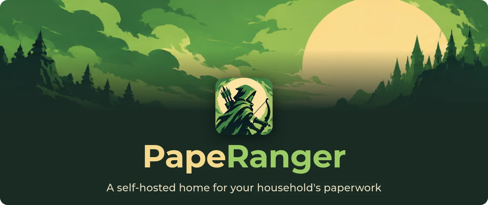

<h1 align="center"></h1>

<p align="center">
  <b>A self-hosted home for your household's paperwork.</b>
</p>

<p align="center">
  <a href="https://github.com/GusFurtado/PapeRanger/releases"></a>
  <a href="https://github.com/GusFurtado/PapeRanger/pkgs/container/paperanger"></a>
  <a href="https://github.com/GusFurtado/PapeRanger/actions/workflows/ci.yml"></a>
  <a href="https://github.com/GusFurtado/PapeRanger/blob/main/LICENSE"></a>
</p>

<p align="center">
  <b><a href="https://www.gustavofurtado.com/PapeRanger/">Documentation</a></b>
</p>

IDs, exam results, receipts, contracts, vaccination cards: photograph a document with your phone
(or upload any file), file it under a section you created, tag it, and find it again later.

The name is *papelada* (Portuguese for "paperwork", or more precisely "a pile of papers")
plus a ranger to keep it in order. Up to v0.4 it was called Papelada; see
[upgrading from Papelada](https://www.gustavofurtado.com/PapeRanger/installation/#upgrading-from-papelada).

## Installation

You need Docker with Compose.

```sh
mkdir paperanger && cd paperanger
curl -O https://raw.githubusercontent.com/GusFurtado/PapeRanger/main/docker-compose.yml
curl -o .env https://raw.githubusercontent.com/GusFurtado/PapeRanger/main/.env.example
mkdir documents
docker compose up -d
```

Then open http://localhost:8080. The settings in `.env` are explained in the
[installation guide](https://www.gustavofurtado.com/PapeRanger/installation/).

## Features

- **Your own sections and tags**: one section per person, pet, car or house, and tags across them.
- **Search** by title, and **expiry dates** with a badge on what expired or expires soon.
- **Multi-page documents** straight from the phone camera, plus PDFs and any other file.
- **Page editing**: crop, rotate, a "scanned" look, or convert to PNG or PDF, always undoable.
- **Plain files you can browse**: the volume is an ordinary folder tree with readable names.
- **Optional encryption at rest**, with the key kept out of the volume.
- **Optional login** for one user, set with two environment variables.
- One small container, no database, no third-party requests. English and Brazilian Portuguese.
