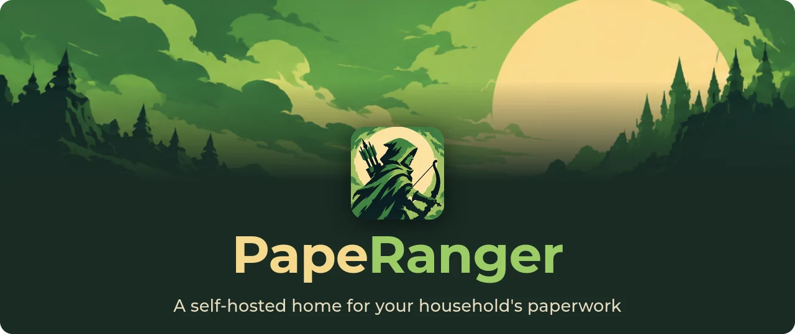
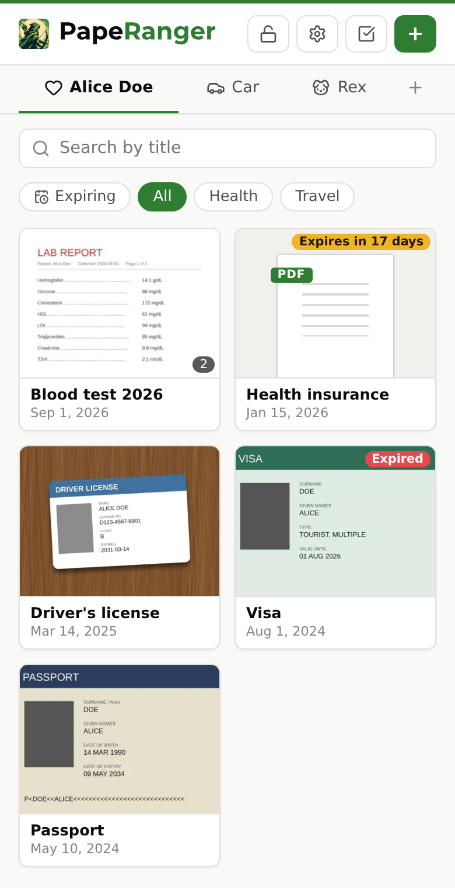
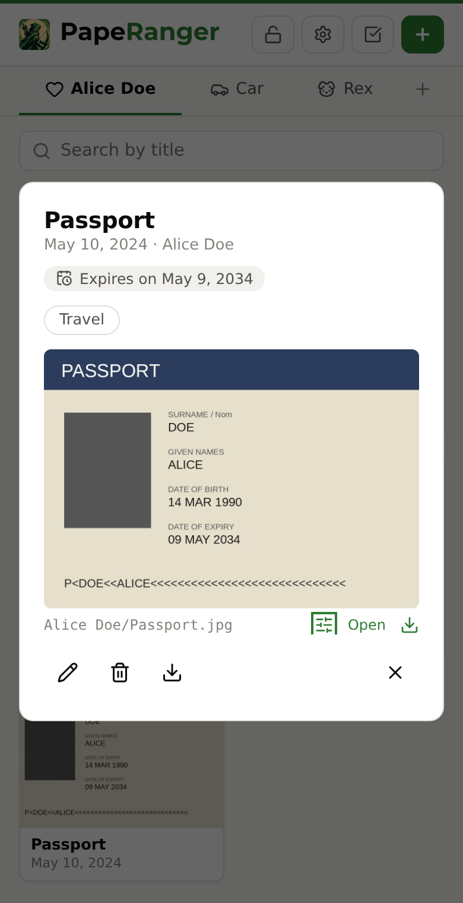
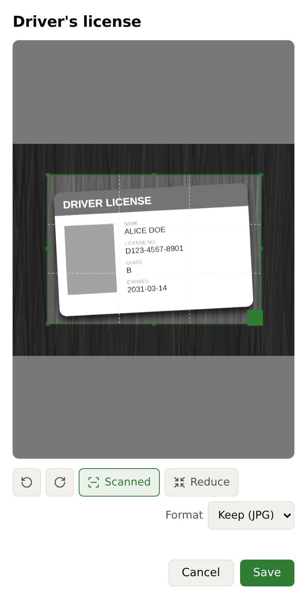

  

**A self-hosted home for your household's paperwork.**

IDs, exam results, receipts, contracts, vaccination cards: photograph a document with your
phone (or upload any file), file it under a section you created, tag it, and find it again
later.

Everything lives in one small container and one folder of plain files, with readable names,
that you can open, copy or back up without the app. Encryption at rest and a login are there
when you want them.

## Features

- **Your own sections**, one per person, pet, car, house or anything else, each with an icon
  you pick, and **tags** that work across them (Health, Taxes, Travel...).
- **Search and filters**: search by title, ignoring case and accents, and filter by tag or by
  expiry date. Documents that expired or expire within 30 days get a badge.
- **Made for the phone camera**: one photo per page, straight from the camera, or PDFs and any
  other file. Photos are turned the right way up and lose the metadata cameras record (GPS
  position, device).
- **Edit a photographed page**: crop, rotate, a "scanned" look, a smaller size, or convert it
  to PNG or PDF. The page as uploaded is kept, so every edit can be undone.
- **Plain files you can browse**: the volume is an ordinary folder tree, and a scan picks up
  files and folders you added by hand.
- **Optional encryption at rest**, switchable any time, with a key that never lives in the
  volume, and an **optional login** for one user.
- **Download** a document as one PDF, or a selection as a zip of files, a zip of PDFs or one
  PDF of them all.
- **One small container**: Python (FastAPI) and a plain JS frontend, no database, no build
  step and no third-party requests (except the API docs page, whose Swagger UI loads from a
  CDN). In English and Brazilian Portuguese, with six color
  themes, each light and dark.

  
  
  

## Where to go next

- [Installation](installation.md): Docker Compose, and the settings in `.env`
- [Your documents on disk](storage.md): how the volume is laid out, and scanning files you add by hand
- [Encryption](encryption.md): encrypting the volume, and keeping the key safe
- [Security](security.md): the optional login, and running PapeRanger outside your home network
- [About](about.md): license, credits, contributing and the project's history
